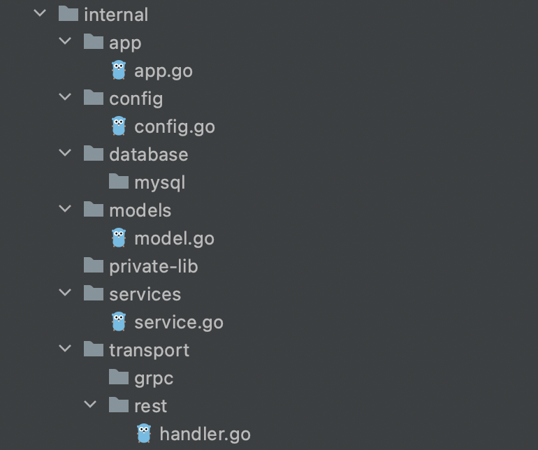
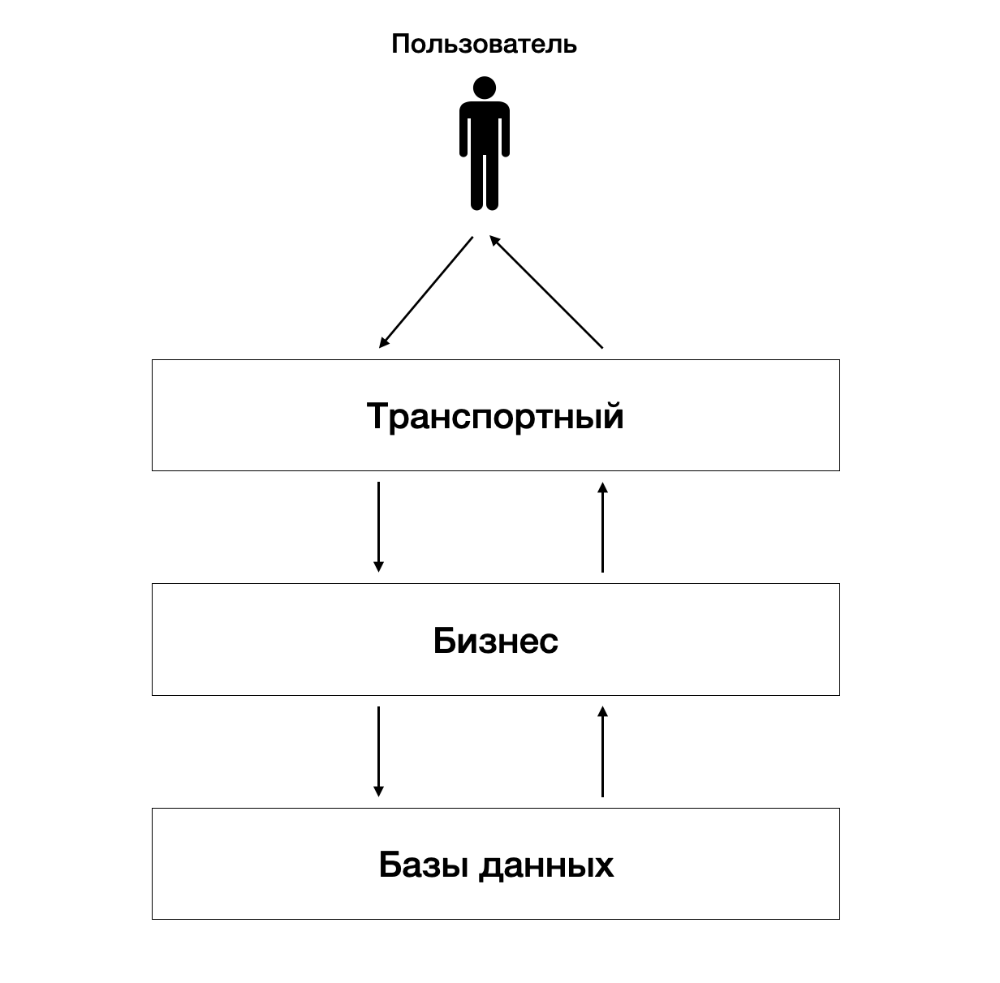

# 🏗️ Структура Go-проекта

> Краткий путеводитель по директориям проекта, их назначению и разделению приложения на архитектурные слои.

## 📑 Содержание

- [Общая структура](#-общая-структура)
- [Основные директории](#-основные-директории)
  - [`/cmd` — точка входа](#cmd--точка-входа)
  - [`/internal` — внутренняя логика](#internal--внутренняя-логика)
  - [`/pkg` — переиспользуемые библиотеки](#pkg--переиспользуемые-библиотеки)
- [Дополнительные директории проекта](#-дополнительные-директории-проекта)
- [Распространённые директории](#-распространённые-директории)
- [Архитектурные слои](#-архитектурные-слои)

---

## 📂 Общая структура

Ниже представлен пример организации проекта. Необязательно использовать все папки: выбирайте те, которые действительно нужны вашему приложению.

```text
.
├── cmd/                    # Точки входа в приложения
│   └── <имя-приложения>/    # main.go и минимальный код запуска
├── internal/               # Внутренний код проекта
│   ├── app/                # Сборка зависимостей и запуск приложения
│   ├── config/             # Инициализация конфигурации
│   ├── database/           # Работа с базами данных
│   ├── models/             # Модели таблиц базы данных
│   ├── services/           # Бизнес-логика
│   └── transport/          # HTTP-сервер, обработчики и маршруты
├── pkg/                    # Библиотеки для повторного использования
├── configs/                # Статические конфигурационные файлы
├── api/                    # API-спецификации и схемы
├── build/                  # Конфигурация сборки и контейнеризации
├── deployments/            # Конфигурации развёртывания
├── docs/                   # Документация проекта
├── scripts/                # Вспомогательные скрипты (опционально)
├── testdata/               # Тестовые данные (опционально)
├── tools/                  # Инструменты разработки (опционально)
├── assets/                 # Изображения, логотипы и другие ресурсы
├── web/                    # Веб-ресурсы и фронтенд (опционально)
├── migrations/             # Миграции базы данных (опционально)
└── README.md               # Описание проекта
```


## 🧩 Основные директории

### `/cmd` — точка входа

В этой директории располагаются **точки входа в приложения**.

- Имя директории каждого приложения должно совпадать с именем исполняемого файла, который вы хотите собрать.
- Не стоит размещать здесь много кода.
- Чаще всего достаточно небольшой функции `main`, которая импортирует и вызывает необходимый код из `/internal` и `/pkg`.

### `/internal` — внутренняя логика

**Сердце приложения.** Здесь хранится внутренняя логика, предназначенная исключительно для использования в рамках разрешённой области кодовой базы.

Пакеты из `/internal` не предназначены для произвольного импорта сторонними приложениями и библиотеками. Начиная с **Go 1.4**, язык поддерживает специальное правило импорта: пакет внутри директории `internal` можно импортировать только из дерева каталогов, расположенного под родительской директорией этого `internal`.

В нашем проекте внутри `/internal` выделяются следующие части:

| Директория | Назначение |
| --- | --- |
| **`/app`** | Место, где собираются зависимости и логика, необходимые для запуска приложения. Содержит метод `Run`, вызываемый из `/cmd`. |
| **`/config`** | Инициализация общих настроек приложения, объявленных в корне проекта. |
| **`/database`** | Слой работы с базой данных: методы взаимодействия с хранилищами. |
| **`/models`** | Структуры, описывающие таблицы базы данных. |
| **`/services`** | Бизнес-слой: основная бизнес-логика приложения. |
| **`/transport`** | Транспортный слой: конфигурация HTTP-сервера, обработчики, порты и другие сетевые компоненты. |

### `/pkg` — переиспользуемые библиотеки

В отличие от `/internal`, директория `/pkg` предназначена для **библиотек, которые можно использовать в других проектах**.

Здесь размещаются общие или кастомные пакеты, чтобы их можно было импортировать в другие приложения, а не копировать код из проекта в проект.

> **Примечание:** если проект небольшой и выделение `/pkg` не даёт практической пользы, эту директорию можно не создавать.



## 🗂️ Дополнительные директории проекта

| Директория | Что хранится |
| --- | --- |
| **`/configs`** | Статические конфигурации приложения, в том числе связанные со сборкой. Обычно это YAML-файлы. |
| **`/api`** | API-документация: спецификации OpenAPI/Swagger, JSON Schema и файлы определения протоколов. |
| **`/build`** | Файлы конфигурации сборки проекта, Docker-контейнеров и других процессов сборки. |
| **`/deployments`** | Файлы развёртывания: плейбуки Ansible, манифесты Docker Compose и Kubernetes, Helm-чарты и настройки. |
| **`/docs`** | Документация кода, архитектуры и дизайна — в дополнение к автоматически создаваемой документации GoDoc. |
| **`README.md`** | Общее описание проекта, с которого другим разработчикам удобно начинать знакомство с кодом. |

## 🧰 Распространённые директории

Следующие директории встречаются во многих проектах, но **необязательны**. Добавляйте их по мере необходимости.

| Директория | Что хранится |
| --- | --- |
| **`/scripts`** | Скрипты сборки, установки, анализа и других операций. Помогают сохранить основной `Makefile` небольшим и простым. |
| **`/testdata`** | Дополнительные тестовые приложения и данные. Структуру можно выбирать свободно; в больших проектах удобно использовать вложенные директории с тестовыми данными. |
| **`/tools`** | Инструменты поддержки и разработки проекта. Они могут импортировать пакеты из `/pkg` и, при соблюдении правил Go, из `/internal`. |
| **`/assets`** | Дополнительные ресурсы приложения: изображения, логотипы и другие файлы. |
| **`/web`** | Компоненты веб-приложения: статические ресурсы, серверные шаблоны и одностраничные приложения (SPA). |
| **`/migrations`** | Миграции баз данных, например SQL-файлы. |

---

## 🧱 Архитектурные слои

Логика приложения разделяется на **три слоя**. Каждый отвечает за свою часть работы.



### 🌐 1. Транспортный слой — `/transport`

Сетевой уровень приложения, через который конечный пользователь взаимодействует с системой.

Здесь принимаются и обрабатываются входящие запросы. После первичной обработки собранная информация передаётся **на бизнес-слой**.

### ⚙️ 2. Бизнес-слой — `/services`

Содержит бизнес-логику, поддерживающую основные функции приложения.

Если для выполнения операции требуется работа с данными, бизнес-слой обращается **к слою базы данных**.

### 🗄️ 3. Слой базы данных — `/database`, `/models`

Отвечает за взаимодействие с постоянными хранилищами данных и техническую обработку информации, которая не относится непосредственно к бизнес-правилам.

Типичные задачи: чтение и запись данных в базу.

### Как взаимодействуют слои

```text
          Пользователь
               │
               ▼
      ┌─────────────────┐
      │ Транспортный    │  HTTP, запросы, обработчики
      │ слой            │
      └────────┬────────┘
               │
               ▼
      ┌─────────────────┐
      │ Бизнес-слой     │  Правила и сценарии приложения
      └────────┬────────┘
               │
               ▼
      ┌─────────────────┐
      │ Слой базы       │  Чтение и запись данных
      │ данных          │
      └─────────────────┘
```

**Главная идея:** транспортный слой отвечает за общение с внешним миром, бизнес-слой — за правила приложения, а слой базы данных — за хранение и получение информации.
